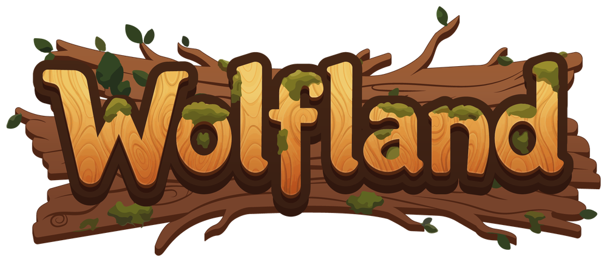

# Bienvenido

Esta es la wiki oficial de **Wolfland Network**, un servidor de Minecraft **Survival Custom** para **Java y Bedrock**. Aquí encontrarás todo lo necesario para unirte, conocer las normas, descubrir los comandos y rangos, y mantenerte al día con las novedades de la comunidad.

  

    
    IP del servidor
    Java &amp; Bedrock
  

  

    

      

        Java
        <code class="wf-ip-code">play.wolfland.pro</code>
      

      <button type="button" class="wf-copy-btn" onclick="copyServerIp(this, 'play.wolfland.pro')">
        <svg viewBox="0 0 24 24" width="15" height="15" fill="none" stroke="currentColor" stroke-width="2" stroke-linecap="round" stroke-linejoin="round"><rect x="9" y="9" width="13" height="13" rx="2" ry="2"></rect><path d="M5 15H4a2 2 0 0 1-2-2V4a2 2 0 0 1 2-2h9a2 2 0 0 1 2 2v1"></path></svg>
        Copiar IP
      </button>
    

    

      

        Bedrock
        <code class="wf-ip-code">play.wolfland.pro</code>
        Puerto: <code class="wf-ip-code">19132</code>
      

      <button type="button" class="wf-copy-btn" onclick="copyServerIp(this, 'play.wolfland.pro:19132')">
        <svg viewBox="0 0 24 24" width="15" height="15" fill="none" stroke="currentColor" stroke-width="2" stroke-linecap="round" stroke-linejoin="round"><rect x="9" y="9" width="13" height="13" rx="2" ry="2"></rect><path d="M5 15H4a2 2 0 0 1-2-2V4a2 2 0 0 1 2-2h9a2 2 0 0 1 2 2v1"></path></svg>
        Copiar IP + Puerto
      </button>
    

  

[:fontawesome-brands-discord: Unirse al Discord](https://discord.com/invite/jCmngqZRFV){ .md-button .md-button--primary }
[:fontawesome-solid-store: Ir a la Tienda](https://wolfland.tebex.store/){ .md-button }
{: .cta-buttons .center }

## :material-rocket-launch: Empieza por aquí { #empieza }

Sigue estos tres pasos para empezar a jugar:

  <a class="wf-step" href="unirse/">
    1
    <strong>Entra al servidor</strong>
    Consigue la IP y sigue los pasos para Java o Bedrock.
  </a>
  <a class="wf-step" href="reglas/">
    2
    <strong>Conoce las reglas</strong>
    Léelas con calma: pueden cambiar sin previo aviso.
  </a>
  <a class="wf-step" href="comandos/">
    3
    <strong>Descubre qué puedes hacer</strong>
    Comandos, rangos y beneficios para disfrutar al máximo.
  </a>

### Para jugadores

  <a class="wf-card" href="reglas/">
    <svg viewBox="0 0 24 24" width="22" height="22" fill="none" stroke="currentColor" stroke-width="1.8" stroke-linecap="round" stroke-linejoin="round" aria-hidden="true"><path d="M12 22s8-4 8-10V5l-8-3-8 3v7c0 6 8 10 8 10z"/><polyline points="9 12 11 14 15 10"/></svg>
    <strong>Reglas</strong>Normas del servidor y del Discord, sanciones y apelaciones.
  </a>
  <a class="wf-card" href="comandos/">
    <svg viewBox="0 0 24 24" width="22" height="22" fill="none" stroke="currentColor" stroke-width="1.8" stroke-linecap="round" stroke-linejoin="round" aria-hidden="true"><polyline points="4 17 10 11 4 5"/><line x1="12" y1="19" x2="20" y2="19"/></svg>
    <strong>Comandos</strong>Todos los comandos disponibles, organizados por categoría.
  </a>
  <a class="wf-card" href="rangos/">
    <svg viewBox="0 0 24 24" width="22" height="22" fill="none" stroke="currentColor" stroke-width="1.8" stroke-linecap="round" stroke-linejoin="round" aria-hidden="true"><circle cx="12" cy="8" r="7"/><polyline points="8.21 13.89 7 23 12 20 17 23 15.79 13.88"/></svg>
    <strong>Rangos</strong>Staff, premium, media y rangos exclusivos.
  </a>
  <a class="wf-card" href="rangos-premium/">
    <svg viewBox="0 0 24 24" width="22" height="22" fill="none" stroke="currentColor" stroke-width="1.8" stroke-linecap="round" stroke-linejoin="round" aria-hidden="true"><polygon points="12 2 15.09 8.26 22 9.27 17 14.14 18.18 21.02 12 17.77 5.82 21.02 7 14.14 2 9.27 8.91 8.26 12 2"/></svg>
    <strong>Rangos Premium</strong>Compara beneficios, kits y comandos de cada rango.
  </a>
  <a class="wf-card" href="eventos/">
    <svg viewBox="0 0 24 24" width="22" height="22" fill="none" stroke="currentColor" stroke-width="1.8" stroke-linecap="round" stroke-linejoin="round" aria-hidden="true"><rect x="3" y="4" width="18" height="18" rx="2" ry="2"/><line x1="16" y1="2" x2="16" y2="6"/><line x1="8" y1="2" x2="8" y2="6"/><line x1="3" y1="10" x2="21" y2="10"/></svg>
    <strong>Eventos</strong>Torneos, concursos y actividades de la comunidad.
  </a>
  <a class="wf-card" href="noticias/">
    <svg viewBox="0 0 24 24" width="22" height="22" fill="none" stroke="currentColor" stroke-width="1.8" stroke-linecap="round" stroke-linejoin="round" aria-hidden="true"><path d="M18 8A6 6 0 0 0 6 8c0 7-3 9-3 9h18s-3-2-3-9"/><path d="M13.73 21a2 2 0 0 1-3.46 0"/></svg>
    <strong>Noticias</strong>Las últimas actualizaciones del servidor.
  </a>

### Comunidad y equipo

  <a class="wf-card" href="https://discord.com/invite/jCmngqZRFV" target="_blank" rel="noopener">
    <svg viewBox="0 0 24 24" width="22" height="22" fill="none" stroke="currentColor" stroke-width="1.8" stroke-linecap="round" stroke-linejoin="round" aria-hidden="true"><path d="M21 11.5a8.38 8.38 0 0 1-.9 3.8 8.5 8.5 0 0 1-7.6 4.7 8.38 8.38 0 0 1-3.8-.9L3 21l1.9-5.7a8.38 8.38 0 0 1-.9-3.8 8.5 8.5 0 0 1 4.7-7.6 8.38 8.38 0 0 1 3.8-.9h.5a8.48 8.48 0 0 1 8 8v.5z"/></svg>
    <strong>Discord</strong>Únete, abre tickets y habla con la comunidad y el staff.
  </a>
  <a class="wf-card" href="https://wolfland.tebex.store/" target="_blank" rel="noopener">
    <svg viewBox="0 0 24 24" width="22" height="22" fill="none" stroke="currentColor" stroke-width="1.8" stroke-linecap="round" stroke-linejoin="round" aria-hidden="true"><path d="M6 2L3 6v14a2 2 0 0 0 2 2h14a2 2 0 0 0 2-2V6l-3-4z"/><line x1="3" y1="6" x2="21" y2="6"/><path d="M16 10a4 4 0 0 1-8 0"/></svg>
    <strong>Tienda oficial</strong>Rangos y beneficios. Es el único lugar válido para comprar.
  </a>
  <a class="wf-card" href="staff/">
    <svg viewBox="0 0 24 24" width="22" height="22" fill="none" stroke="currentColor" stroke-width="1.8" stroke-linecap="round" stroke-linejoin="round" aria-hidden="true"><path d="M12 22s8-4 8-10V5l-8-3-8 3v7c0 6 8 10 8 10z"/></svg>
    <strong>Staff</strong>Conoce al equipo que cuida el servidor.
  </a>
  <a class="wf-card" href="postulaciones/">
    <svg viewBox="0 0 24 24" width="22" height="22" fill="none" stroke="currentColor" stroke-width="1.8" stroke-linecap="round" stroke-linejoin="round" aria-hidden="true"><path d="M17 21v-2a4 4 0 0 0-4-4H5a4 4 0 0 0-4 4v2"/><circle cx="9" cy="7" r="4"/><path d="M23 21v-2a4 4 0 0 0-3-3.87"/><path d="M16 3.13a4 4 0 0 1 0 7.75"/></svg>
    <strong>Postulaciones</strong>Requisitos y proceso para formar parte del equipo.
  </a>
  <a class="wf-card" href="rangos-media/">
    <svg viewBox="0 0 24 24" width="22" height="22" fill="none" stroke="currentColor" stroke-width="1.8" stroke-linecap="round" stroke-linejoin="round" aria-hidden="true"><polygon points="23 7 16 12 23 17 23 7"/><rect x="1" y="5" width="15" height="14" rx="2" ry="2"/></svg>
    <strong>Creadores de contenido</strong>Rangos media y requisitos para streamers y youtubers.
  </a>
  <a class="wf-card" href="servicios/">
    <svg viewBox="0 0 24 24" width="22" height="22" fill="none" stroke="currentColor" stroke-width="1.8" stroke-linecap="round" stroke-linejoin="round" aria-hidden="true"><rect x="2" y="7" width="20" height="14" rx="2" ry="2"/><path d="M16 21V5a2 2 0 0 0-2-2h-4a2 2 0 0 0-2 2v16"/></svg>
    <strong>Servicios</strong>Para creadores y artistas que quieren ofrecer sus servicios.
  </a>

---

## :material-information-outline: Sobre Wolfland Network { #sobre-nosotros }

**Wolfland Network** es un servidor de Minecraft **Survival Custom**: la experiencia clásica de supervivencia, con contenido y mecánicas propias, pensada para que explorar, progresar y jugar en comunidad sea cada vez mejor. Somos un **servidor pequeño con el objetivo de ser grande**, y trabajamos cada día para lograrlo.

### Nuestra historia

Wolfland tiene una historia de esfuerzo, caídas y regresos. Este es nuestro camino:

  

    Los inicios
    <strong>TheWolfes</strong>
    
Todo empezó con un Realm de Minecraft Bedrock y solo 10 jugadores. Nuestra comunidad vivía en un grupo de Messenger de Facebook.

  

  

    Diciembre de 2023
    <strong>Nace Wolfland</strong>
    
Surge la idea de Wolfland y, desde entonces, el proyecto no se ha detenido.

  

  

    Marzo de 2024
    <strong>Primer cierre</strong>
    
Tuvimos que cerrar por problemas que no pudimos resolver a tiempo.

  

  

    Noviembre de 2024
    <strong>Volvemos a intentarlo</strong>
    
Con muy poco presupuesto lo preparamos todo en una sola semana y abrimos el <strong>2 de diciembre</strong>. Desde ahí, seguimos adelante.

  

  

    Junio de 2025
    <strong>Segundo cierre</strong>
    
Al ser una sola persona la encargada de todo, el estrés era demasiado y decidimos parar.

  

  

    Enero y marzo de 2026
    <strong>Nueva apertura</strong>
    
En enero anunciamos otra apertura y abrimos en marzo de 2026.

  

  

    Julio de 2026
    <strong>Mantenimiento indefinido</strong>
    
Pausamos el servidor para mejorar muchas cosas y traer una mejor calidad.

  

  

    Diciembre de 2026 Próximamente
    <strong>Reapertura: el prime de Wolfland</strong>
    
Volvemos con todo lo que mejoramos durante el mantenimiento. <strong>¡Se viene el prime de Wolfland!</strong>

  

!!! quote "Sin rendirnos"
    Hemos recibido críticas, enojos e incluso malos deseos, y hemos atravesado problemas personales. **Aun así, no nos hemos rendido.** Cada pausa fue una oportunidad para volver mejores, y cada regreso es posible gracias a quienes creen en este proyecto.

**Esperamos que formes parte de esta comunidad y de todo lo que viene.**

!!! abstract "Nuestro compromiso"
    Daremos lo mejor para que la comunidad de Wolfland Network sea **la mejor de todas**, mejorando y trayendo cosas nuevas. **Nuestra prioridad es la comodidad y la jugabilidad de nuestros miembros.**

### Lo que nos define

  

    <svg viewBox="0 0 24 24" width="22" height="22" fill="none" stroke="currentColor" stroke-width="1.8" stroke-linecap="round" stroke-linejoin="round" aria-hidden="true"><path d="M4 15s1-1 4-1 5 2 8 2 4-1 4-1V3s-1 1-4 1-5-2-8-2-4 1-4 1z"/><line x1="4" y1="22" x2="4" y2="15"/></svg>
    <strong>Perseverancia</strong>
    Desde diciembre de 2023 no nos hemos rendido, y seguimos adelante.
  

  

    <svg viewBox="0 0 24 24" width="22" height="22" fill="none" stroke="currentColor" stroke-width="1.8" stroke-linecap="round" stroke-linejoin="round" aria-hidden="true"><path d="M17 21v-2a4 4 0 0 0-4-4H5a4 4 0 0 0-4 4v2"/><circle cx="9" cy="7" r="4"/><path d="M23 21v-2a4 4 0 0 0-3-3.87"/><path d="M16 3.13a4 4 0 0 1 0 7.75"/></svg>
    <strong>Comunidad</strong>
    Queremos que sea la mejor de todas, hecha entre todos.
  

  

    <svg viewBox="0 0 24 24" width="22" height="22" fill="none" stroke="currentColor" stroke-width="1.8" stroke-linecap="round" stroke-linejoin="round" aria-hidden="true"><line x1="6" y1="12" x2="10" y2="12"/><line x1="8" y1="10" x2="8" y2="14"/><line x1="15" y1="13" x2="15.01" y2="13"/><line x1="18" y1="11" x2="18.01" y2="11"/><rect x="2" y="6" width="20" height="12" rx="2"/></svg>
    <strong>Comodidad y jugabilidad</strong>
    Es nuestra prioridad: que jugar aquí sea fácil y agradable.
  

  

    <svg viewBox="0 0 24 24" width="22" height="22" fill="none" stroke="currentColor" stroke-width="1.8" stroke-linecap="round" stroke-linejoin="round" aria-hidden="true"><polyline points="23 6 13.5 15.5 8.5 10.5 1 18"/><polyline points="17 6 23 6 23 12"/></svg>
    <strong>Mejora constante</strong>
    Seguimos mejorando y trayendo cosas nuevas.
  

### Qué hace especial a nuestro Survival Custom

Un survival pensado para que cada día tengas algo nuevo que hacer. Te invitamos a descubrirlo:

  

    <svg viewBox="0 0 24 24" width="22" height="22" fill="none" stroke="currentColor" stroke-width="1.8" stroke-linecap="round" stroke-linejoin="round" aria-hidden="true"><path d="M3 21V8l3 2V5l3 2V4h6v3l3-2v5l3-2v13z"/><path d="M10 21v-5a2 2 0 0 1 4 0v5"/></svg>
    <strong>Mazmorras</strong>Mazmorras llenas de desafíos para explorar.
  

  

    <svg viewBox="0 0 24 24" width="22" height="22" fill="none" stroke="currentColor" stroke-width="1.8" stroke-linecap="round" stroke-linejoin="round" aria-hidden="true"><path d="M12 2a8 8 0 0 0-8 8c0 2.5 1.2 4.3 3 5.5V19a1 1 0 0 0 1 1h8a1 1 0 0 0 1-1v-3.5c1.8-1.2 3-3 3-5.5a8 8 0 0 0-8-8z"/><circle cx="9" cy="11" r="1.2"/><circle cx="15" cy="11" r="1.2"/><line x1="10" y1="20" x2="10" y2="22"/><line x1="14" y1="20" x2="14" y2="22"/></svg>
    <strong>Jefes customizados</strong>Jefes personalizados que ponen a prueba tus habilidades.
  

  

    <svg viewBox="0 0 24 24" width="22" height="22" fill="none" stroke="currentColor" stroke-width="1.8" stroke-linecap="round" stroke-linejoin="round" aria-hidden="true"><polyline points="20 12 20 22 4 22 4 12"/><rect x="2" y="7" width="20" height="5"/><line x1="12" y1="22" x2="12" y2="7"/><path d="M12 7H7.5a2.5 2.5 0 0 1 0-5C11 2 12 7 12 7z"/><path d="M12 7h4.5a2.5 2.5 0 0 0 0-5C13 2 12 7 12 7z"/></svg>
    <strong>Kits épicos</strong>Kits épicos disponibles, además de los de los rangos de pago.
  

  

    <svg viewBox="0 0 24 24" width="22" height="22" fill="none" stroke="currentColor" stroke-width="1.8" stroke-linecap="round" stroke-linejoin="round" aria-hidden="true"><path d="M14.7 6.3a1 1 0 0 0 0 1.4l1.6 1.6a1 1 0 0 0 1.4 0l3.77-3.77a6 6 0 0 1-7.94 7.94l-6.91 6.91a2.12 2.12 0 0 1-3-3l6.91-6.91a6 6 0 0 1 7.94-7.94l-3.76 3.76z"/></svg>
    <strong>Trabajos mejorados</strong>Un sistema de trabajos mejorado para progresar mientras juegas.
  

  

    <svg viewBox="0 0 24 24" width="22" height="22" fill="none" stroke="currentColor" stroke-width="1.8" stroke-linecap="round" stroke-linejoin="round" aria-hidden="true"><rect x="3" y="11" width="18" height="11" rx="2" ry="2"/><path d="M7 11V7a5 5 0 0 1 10 0v4"/></svg>
    <strong>Protecciones mejoradas</strong>Un sistema de protecciones mejorado para cuidar tus terrenos y construcciones.
  

  

    <svg viewBox="0 0 24 24" width="22" height="22" fill="none" stroke="currentColor" stroke-width="1.8" stroke-linecap="round" stroke-linejoin="round" aria-hidden="true"><circle cx="6" cy="10" r="2"/><circle cx="10" cy="6" r="2"/><circle cx="14" cy="6" r="2"/><circle cx="18" cy="10" r="2"/><path d="M12 12c-3 0-6 3-6 6 0 2 2 3 3.5 2.5.9-.3 1.5-.5 2.5-.5s1.6.2 2.5.5c1.5.5 3.5-.5 3.5-2.5 0-3-3-6-6-6z"/></svg>
    <strong>Mascotas</strong>Mascotas para acompañarte en tu aventura.
  

  

    <svg viewBox="0 0 24 24" width="22" height="22" fill="none" stroke="currentColor" stroke-width="1.8" stroke-linecap="round" stroke-linejoin="round" aria-hidden="true"><polygon points="3 11 22 2 13 21 11 13 3 11"/></svg>
    <strong>Monturas Próximamente</strong>Monturas para recorrer el mundo.
  

  

    <svg viewBox="0 0 24 24" width="22" height="22" fill="none" stroke="currentColor" stroke-width="1.8" stroke-linecap="round" stroke-linejoin="round" aria-hidden="true"><circle cx="12" cy="12" r="10"/><polygon points="16.24 7.76 14.12 14.12 7.76 16.24 9.88 9.88 16.24 7.76"/></svg>
    <strong>Mundo de exploración</strong>Un mundo principal con estructuras y biomas mejorados, creado para explorar.
  

  

    <svg viewBox="0 0 24 24" width="22" height="22" fill="none" stroke="currentColor" stroke-width="1.8" stroke-linecap="round" stroke-linejoin="round" aria-hidden="true"><polyline points="23 6 13.5 15.5 8.5 10.5 1 18"/><polyline points="17 6 23 6 23 12"/></svg>
    <strong>Rankup</strong>Un sistema de rankup para avanzar y progresar.
  

  

    <svg viewBox="0 0 24 24" width="22" height="22" fill="none" stroke="currentColor" stroke-width="1.8" stroke-linecap="round" stroke-linejoin="round" aria-hidden="true"><rect x="3" y="4" width="18" height="18" rx="2" ry="2"/><line x1="16" y1="2" x2="16" y2="6"/><line x1="8" y1="2" x2="8" y2="6"/><line x1="3" y1="10" x2="21" y2="10"/></svg>
    <strong>Recompensas diarias</strong>Entra cada día y recibe tus recompensas.
  

  

    <svg viewBox="0 0 24 24" width="22" height="22" fill="none" stroke="currentColor" stroke-width="1.8" stroke-linecap="round" stroke-linejoin="round" aria-hidden="true"><polyline points="17 1 21 5 17 9"/><path d="M3 11V9a4 4 0 0 1 4-4h14"/><polyline points="7 23 3 19 7 15"/><path d="M21 13v2a4 4 0 0 1-4 4H3"/></svg>
    <strong>Tradeos y crafteos</strong>Muchos tradeos y crafteos que mejoran la experiencia y el progreso.
  

  

    <svg viewBox="0 0 24 24" width="22" height="22" fill="none" stroke="currentColor" stroke-width="1.8" stroke-linecap="round" stroke-linejoin="round" aria-hidden="true"><polygon points="13 2 3 14 12 14 11 22 21 10 12 10 13 2"/></svg>
    <strong>Mejoras constantes</strong>Con cada día que pasa, el servidor mejora más.
  

Y además, estos sistemas te esperan en el servidor:

  Mundos de recursos
  Misiones <code>/quest</code>
  Subastas <code>/ah</code>
  Tiendas con cofres (ShopChest)
  Warps personales
  Bóvedas personales <code>/pv</code>
  Cajas con llaves legendarias

### Ficha del servidor

| Dato | Detalle |
|------|---------|
| **Modo de juego** | Survival Custom |
| **Ediciones** | Java y Bedrock |
| **IP** | `play.wolfland.pro` |
| **Puerto Bedrock** | `19132` |
| **Idiomas** | Español e inglés |
| **Inicio del proyecto** | Diciembre de 2023 |
| **Comunidad** | [Discord](https://discord.com/invite/jCmngqZRFV) |
| **Tienda oficial** | [wolfland.tebex.store](https://wolfland.tebex.store/) |

---

## :material-help-circle-outline: Preguntas frecuentes { #faq }

??? question "¿Puedo jugar desde Bedrock?"
    Sí. Wolfland Network acepta **Java y Bedrock**. En Bedrock usa la IP `play.wolfland.pro` con el puerto `19132`. Los pasos están en [Cómo unirse](unirse.md).

??? question "¿Qué idiomas se usan en el servidor?"
    Los idiomas oficiales son el **español** y el **inglés**. Usa uno de ellos en el chat público.

??? question "¿Dónde puedo comprar rangos?"
    **Solo en la [tienda oficial](https://wolfland.tebex.store/).** Cualquier compra fuera de ella no está permitida ni se reconoce. Más detalles en las [reglas de la tienda](reglas.md#4-tienda-oficial-tebex).

??? question "¿Cómo contacto con el staff o abro un ticket?"
    Entra a nuestro [Discord](https://discord.com/invite/jCmngqZRFV) y abre un ticket. Es el canal oficial para soporte, reportes y apelaciones.

??? question "¿Cómo puedo formar parte del staff?"
    Las postulaciones se hacen por ticket en el Discord y tienen requisitos. Revísalos en [Postulaciones](postulaciones.md).

??? question "¿Puedo ser creador de contenido del servidor?"
    Sí, si cumples los requisitos. Mira los rangos media en [Creadores de contenido](rangos-media.md).

??? question "¿Dónde veo las novedades?"
    En la sección de [Noticias](noticias.md) y en el [Discord](https://discord.com/invite/jCmngqZRFV).

---

## :material-heart: Te esperamos { #te-esperamos }

**Esperamos que formes parte de esta comunidad.** Aquí hay un lugar para ti: explora, construye, haz amigos y vive la aventura con nosotros. ¡Te estamos esperando en Wolfland!

[:fontawesome-brands-discord: Unirme al Discord](https://discord.com/invite/jCmngqZRFV){ .md-button .md-button--primary }
[:material-login: Cómo unirse](unirse.md){ .md-button }
{: .cta-buttons .center }
